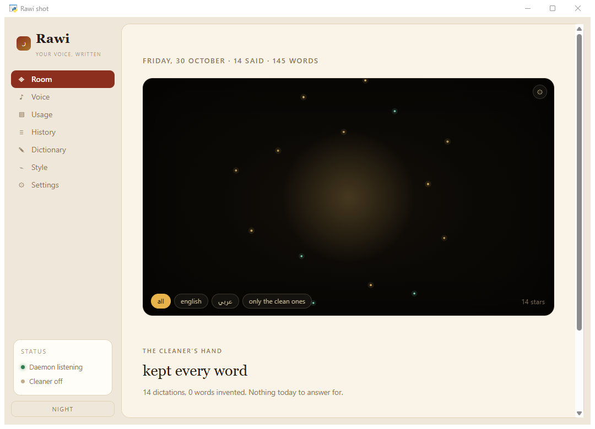
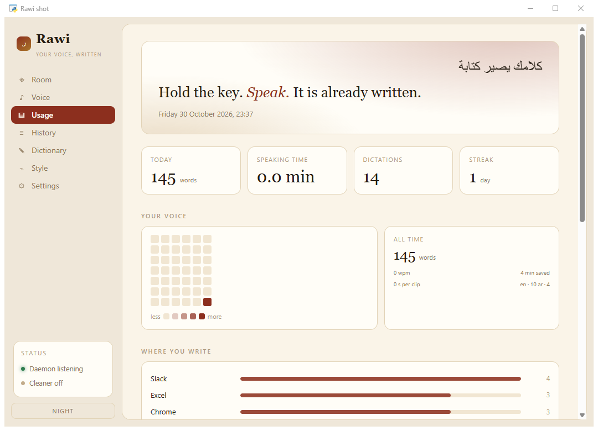
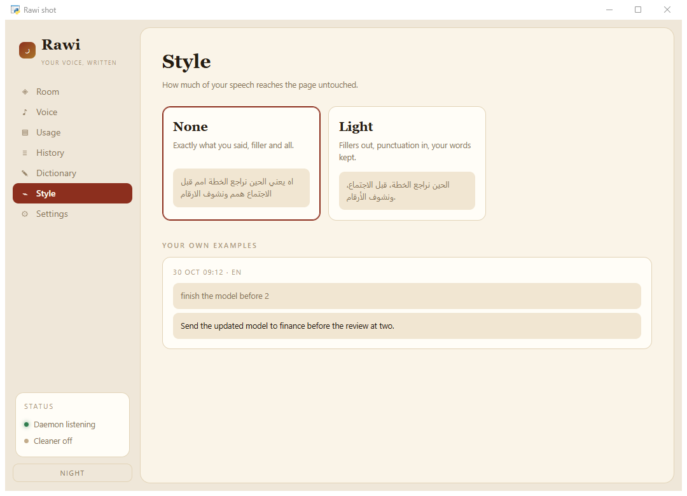
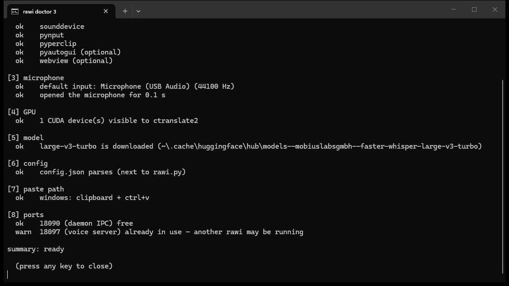

# rawi · راوي

**Local-first dictation.** Hold a key, speak Arabic or English, and the words land in whatever you were
typing into — transcribed on your own machine, by your own GPU.

**Website: [rawi-dictation.vercel.app](https://rawi-dictation.vercel.app)**, in English and العربية: what it is, a short demo, and a
step-by-step install.

`rawi` (راوي) means *narrator*. The premise is simple: your voice is yours. Nothing is uploaded, there
is no account, and no service decides when you may speak.



---

## What it does

- **Hold to talk** — `Ctrl` (left) held: speak, release, done. A **double-tap** latches it hands-free.
- **Arabic and English, mixed freely.** Language is detected per utterance with a stickiness rule so it
  does not flip mid-sentence; `F10` cycles a hard lock (`auto → العربية → English`) when you want one.
- **Any app.** It pastes at the cursor and restores your clipboard afterwards.
- **A pill on screen** while you speak, so you can see it heard you.
- **The ear** (`F8`) — an always-listening mode with a noise floor that learns, so you can talk without
  holding anything. It never writes into your document by itself.
- **`F9` re-pastes the last line** — for when the paste landed in the wrong window.
- **A hub window** (`rawi-app.bat`): Room, Voice, Usage, History, Dictionary, Style, Settings. Two themes.
- **An optional local cleaner** — any OpenAI-compatible server on `localhost` can tidy filler words. It is
  off by default, and when it is on, **the raw transcript is stored next to the cleaned one**.
- **A dictionary** of names and terms, applied as a bias before transcription, not as a find-and-replace
  after.
- **Nothing leaves your machine.** No telemetry, no cloud key, no subscription.

| usage | style |
|---|---|
|  |  |

## What it is not

- Not a meeting recorder, not a notes app: one utterance in, one paste out.
- Not a speech engine of its own — it wraps [`faster-whisper`](https://github.com/SYSTRAN/faster-whisper),
  which does the hard part.

## Requirements

- **Windows 10/11**, used daily by the maintainer, or **macOS** on Apple silicon, tested end to end on an
  M1 Pro with macOS 15.1 (see *On a Mac* below). X11 Linux has code paths (see *Platforms*) that nobody
  has run yet.
- Python 3.10 – 3.12.
- An NVIDIA GPU is optional but strongly recommended: `large-v3-turbo` transcribes a sentence in
  well under a second on a modern GPU. On CPU use `small` or `base` with `compute_type: int8`.

## Quickstart

```bat
git clone https://github.com/Yousifus/rawi.git
cd rawi
python -m venv .venv
.venv\Scripts\activate
pip install -r requirements.txt
copy config.example.json config.json
python rawi.py --doctor
```

`--doctor` checks the interpreter, the packages, the microphone, CUDA, the model, the config, the paste
path and the ports — and tells you which one is wrong before you spend an evening guessing. Add `--deep`
to also load the model (slow, but it proves the whole path).



Then start it:

```bat
python rawi.py
```

The first run downloads the Whisper weights (about 1.5 GB for `large-v3-turbo`) from Hugging Face into
your local cache. After that, no network is needed at all.

### On a Mac

Tested on a MacBook Pro (M1 Pro, macOS 15.1, Python 3.12). The step-by-step checklist is
[docs/MACOS-TESTING.md](docs/MACOS-TESTING.md).

1. In System Settings, Privacy and Security, give **Accessibility** and **Microphone** to the app you run
   rawi from (Terminal or iTerm). Without Accessibility the line is transcribed but never pasted, and
   nothing warns you.
2. Use Python 3.10 to 3.12. The `python3` that ships with macOS is 3.9, which is too old.

```bash
git clone https://github.com/Yousifus/rawi.git && cd rawi
python3.12 -m venv .venv && source .venv/bin/activate
pip install -r requirements.txt
cp config.example.json config.json      # then set "model": "small", "compute_type": "int8"
python rawi.py --doctor                 # "no CUDA device" is expected on a Mac
python rawi.py
```

On the M1 Pro, `small` took about 2.5 to 3.5 seconds a line in Arabic and English. `large-v3-turbo` took
about 10 seconds a line, with clearly better Arabic, especially in dialect. On macOS rawi shows a **menu
bar icon** instead of the dock: a mic when ready, a filled mic while recording, an ear when always
listening is on, and a crossed-out mic when it is not running. Its menu starts and stops dictation,
opens the hub, and quits everything. On a Mac keyboard the F keys may need `fn`.

## Keys

| key | what it does |
|---|---|
| `Ctrl` (left, hold) | record while held · **double-tap** to latch |
| `F8` | the ear: always-listening on / off |
| `F9` | paste the last transcript again |
| `F10` | language lock: `auto → العربية → English` |
| `F7` | voice mode: speak the transcript instead of pasting it (needs the optional voice server) |

All of them are config keys, so you can remap any of them.

## Voice

`F7` speaks a transcript instead of pasting it. The server stays off until you start it. The default
engine is Kokoro (English only). It is not installed unless you uncomment `kokoro` in
`requirements.txt`.

Arabic needs Piper: set `"engine": "piper"` in `voice.json`. `piper-tts` is **GPL-3.0-or-later**.
It is optional and never installed by default, so a packager can ship rawi's MIT source without it
and should not bundle the package in. The only Arabic voice Piper publishes is `ar_JO-kareem`
(this build uses `ar_JO-kareem-medium`). Its dataset has no stated licence, and the voice was
fine-tuned from `en_US-lessac-medium`. The English default is `en_US-libritts_r-medium`. Its own
dataset (LibriTTS-R) is **CC BY 4.0**, but its model card says it too was fine-tuned from
`en_US-lessac-medium`, and the Lessac dataset's licence does not allow commercial voice synthesis.
So check both voices before shipping voice mode in a commercial product. The one English Piper
voice trained from scratch on public-domain data is `en_GB-cori-high` (British): for that accent, or
for no licence question at all, set `"voice_en": "en_GB-cori-high"` in `voice.json`. The old default,
`en_US-ryan-high`, is CC BY-NC-SA 4.0 (non-commercial) and is not selected on its own.

## Configuration

`config.json` sits next to `rawi.py` and is created on first run (or copy `config.example.json`).
Every key is optional; the table below covers the ones worth knowing.

| key | default | meaning |
|---|---|---|
| `hold_key` | `ctrl_l` | the key held while speaking |
| `mode` | `hold` | `hold`, `toggle`, or `latch` |
| `model` | `large-v3-turbo` | any `faster-whisper` size, or a path to a local CTranslate2 model |
| `compute_type` | `float16` | `float16` on GPU, `int8` on CPU |
| `language` | `auto` | `auto`, `ar`, `en`, … |
| `languages` | `["ar", "en"]` | the languages you actually speak. The probe weighs only these, so a short line is a choice between two rather than between a hundred; a language outside this list is never forced (with nothing of yours above the floor and no hint, Whisper decides freely), and a single string is accepted. The Arabic and English prompts, and the romanised second look, are tuned for this pair |
| `paste` | `true` | paste at the cursor instead of only copying |
| `restore_clipboard` | `true` | put your old clipboard back after pasting |
| `log` | `false` | keep a transcript history (`transcripts.jsonl`) |
| `min_seconds` | `0.25` | ignore taps shorter than this |
| `max_seconds` | `{hold: 300, toggle: 0, latch: 0}` | the longest one recording may run, per mode. The default is a ceiling on a hold, because a hold whose key-up is missed behaves exactly like a latched recording, and no cap on toggle or latch, because those are started on purpose for long dictation. `0` = no cap, and any mode can take its own number. When a cap is reached rawi transcribes what it has, says why it stopped (`cap 300s` in the log), and if a key is still down at that moment it is not pasted (the text goes to the clipboard and the pill says so), because injecting Ctrl+V under a held Ctrl drops your modifier state A bare number is the old form and is ignored with one line at startup |
| `repeat_collapse` | `{min_repeats: 8}` | collapse a word or phrase repeated this many times (Whisper loops); dhikr and laughter are exempt at any count. `keep` **adds** to that list, it never replaces it, so adding one phrase cannot switch off another. A single word chanted alone (e.g. «الله» nine times) looks exactly like a loop, so it collapses unless you add it: `{keep: ["الله"]}`. The other side of the same rule: a loop of a five-word sentence is never collapsed either, because the unit it looks for is at most four words |
| `listen` | `{key: "f8", silence_ms: 700, …}` | the always-on ear and its thresholds |

## Platforms

| | Windows | macOS | Linux (X11) |
|---|---|---|---|
| record, transcribe, dictionary | ✅ | ✅ tested (M1 Pro) | ✅ expected |
| paste | `Ctrl+V` | `⌘V` + **Accessibility permission** | `Ctrl+V`, needs `xdotool` |
| focused-app name (for per-app profiles) | `pygetwindow` | `osascript` | `xdotool` |
| pill | ✅ | ✅ floating, never takes focus | untested |
| dock / menu bar | dock ✅ | menu bar icon ✅ | untested |
| hub window | ✅ (+ tray) | ✅ (no tray) | untested |
| beep | `winsound` | `afplay` | terminal bell |

The macOS port was made to work by [Abdulrahman Aldosari](https://abdulrahmankhalid.com/), who ran rawi on his Mac on 31 Oct 2026 and sent the fixes:
the pill runs on the main thread there, left Ctrl is recognised under its macOS name, the hub's
Windows-only calls have macOS versions, and the dock is replaced by a menu bar item. On a Mac the
double-tap latch, F8, F9 and F10 have not been tried yet. Linux paths exist but are untested.


### On a machine without an NVIDIA GPU

`rawi` runs on CPU. It is slower and it is honest about it: with `small` on `int8`, expect **a few
seconds per line** (measured: 8–11 s for ordinary Arabic lines on a laptop CPU, 23 s for the first one
while the model warms, 41 s for a long sentence). Set `"device": "cpu"` to force it, or leave the default
`"auto"` and rawi will notice there is no CUDA device and choose CPU itself — and fall back to CPU if a
CUDA load fails for any reason.

Two things follow from the slower path, and both are handled:

- **Nothing is dropped while the model is busy.** A recording made during a transcription is held in a
  short queue (up to 8) and processed in order, so a slow machine never eats a sentence.
- **The pill tells you.** You'll see `queued · one at a time` instead of a silent gap.

## Privacy, precisely

- Audio lives in memory and is discarded after transcription.
- **History is off by default** in this build. Turn `log` on and it writes a local `transcripts.jsonl`
  that you can delete, grep, or ignore.
- The optional cleaner talks to a `localhost` endpoint you configure. If none is configured, nothing is
  sent anywhere — the code path does not exist.
- No analytics, no crash reporting, no update pings.

## Tests

```bash
python -m unittest discover -s tests
```

23 tests over the pure logic — normalisation, the fidelity meter, snippets, dictionary repair, config
invariants. No microphone, no GPU, no clipboard: they run in a millisecond, so you can run them after
every change.

## Repository layout

```
rawi.py            the daemon: hotkeys, recording, transcription, paste, the ear, IPC
rawi_app.py        the hub window (pywebview) + tray icon
rawi_dock.py       the small dock (Windows)
rawi_menubar.py    the menu bar icon (macOS), in place of the dock
wave_overlay.py    the pill
rawi_mood.py       a one-word mood tag for the history
stats.py           local usage statistics
app.html           the hub's UI (two themes)
voice_out.py       optional: a resident Kokoro TTS server for voice mode
tests/             unit tests (stdlib unittest)
docs/screens/      the screenshots above
site/              the landing page (static, bilingual), deployed at rawi-dictation.vercel.app
ARCHITECTURE.md    how a sentence travels from your mouth to the cursor
```

## Roadmap

- [x] macOS: tested end to end on Apple silicon, with a menu bar icon (Linux paths implemented, untested)
- [ ] Streaming transcription (words appear while you speak)
- [ ] A benchmark script so people can compare models on their own hardware
- [ ] Package as a single executable (`pyinstaller`)

## Credits

Built by [Yousifus](https://github.com/Yousifus), for daily use in Arabic and English. The macOS port,
including the menu bar icon, is by [Abdulrahman Aldosari](https://abdulrahmankhalid.com/)
([@liling-png](https://github.com/liling-png)).
Stands on `faster-whisper`, `ctranslate2`, `sounddevice`, `pynput`, `pywebview` and, for voice mode,
`kokoro`. Whisper is OpenAI's model, MIT licensed.

## License

MIT. Take it, fork it, teach with it.
